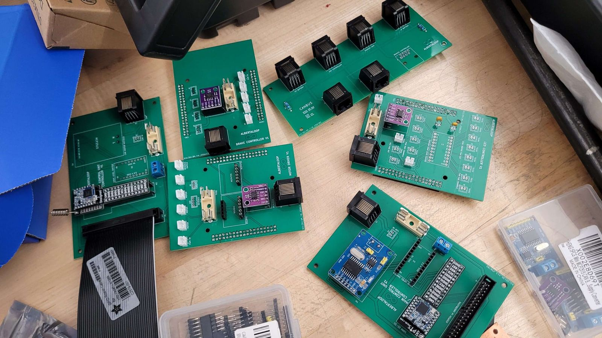

[Albertaloop](http://albertaloop.ca/) is the University of Alberta's hyperloop team. For the 2025–2026 pod I wrote the firmware and designed the PCBs for the subsystem nodes: the **brakes controller**, the **motor driver** and the **LED controller**. Each one is an STM32 Nucleo-F446RE on a custom carrier board, and they all talk to the pod's main computer over a CAN bus.

**[Main repo](https://github.com/albertaloop/T_SWE_2025_2026/tree/main)** · **[CAN drivers branch](https://github.com/albertaloop/T_SWE_2025_2026/tree/CANdrivers)**

## System Overview

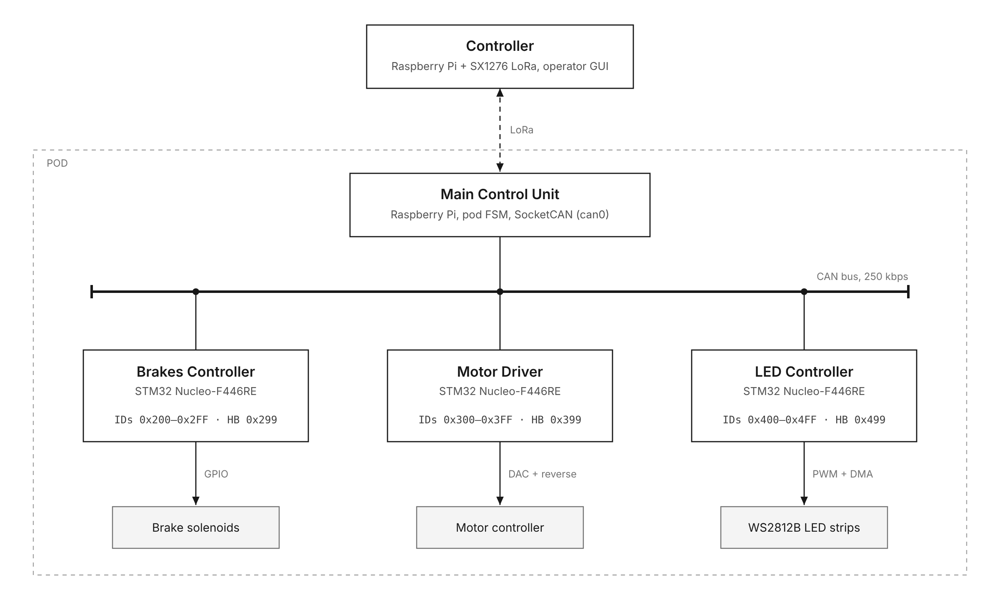

The operator drives the pod from a GUI on a Raspberry Pi controller, which sends commands over **LoRa** to the pod's **Main Control Unit**, another Raspberry Pi. The MCU runs the pod's state machine (a py_trees behaviour tree) and translates each command into CAN frames for the subsystem nodes. Each node gets its own block of CAN IDs and broadcasts a **heartbeat** back, so the MCU can fault the pod if a node goes quiet (10 s timeout).

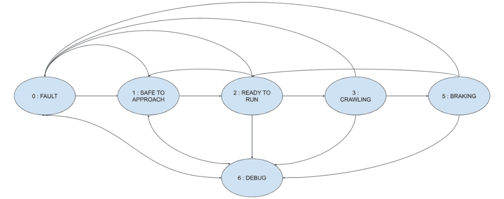

$$
\begin{array}{|l|l|}
\hline
\textbf{State} & \textbf{Description} \\
\hline
\text{FAULT} & \text{Critical failure (comms loss, BMS, sensors, brakes): controlled stop} \\
\text{SAFE TO APPROACH} & \text{Stationary, brakes engaged, safe for people} \\
\text{READY TO LAUNCH} & \text{All systems verified, waiting for commands} \\
\text{CRAWLING} & \text{Low-speed propulsion for controlled movement} \\
\text{BRAKING} & \text{Normal or emergency braking} \\
\text{DEBUG} & \text{Subsystem diagnostics from the GUI} \\
\hline
\end{array}
$$

The high-speed LAUNCH state was left out for the K-Days demo, so the pod only crawls.

## PCBs

Every board follows the same pattern: Nucleo headers on both sides, an **MCP2551 CAN transceiver** with an **RJ45** jack for the bus, a fused power input and screw terminals for the outputs. The boards were designed so the Nucleo just plugs in.

### Brakes Controller

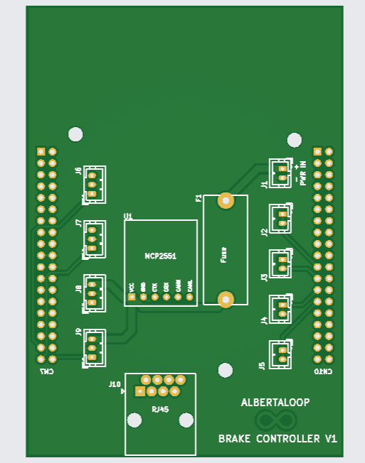

Drives the pneumatic brake solenoids from the Nucleo's GPIOs through the connectors on the board, with the MCP2551 and RJ45 for CAN.

### Motor Driver

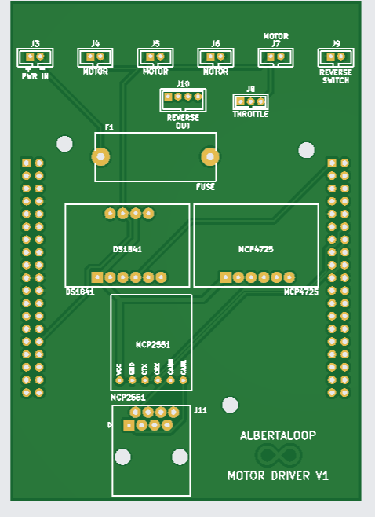

Outputs for the motors, a throttle output and a reverse switch, with footprints for an MCP4725 DAC and a DS1841 next to the CAN transceiver.

### LED Controller

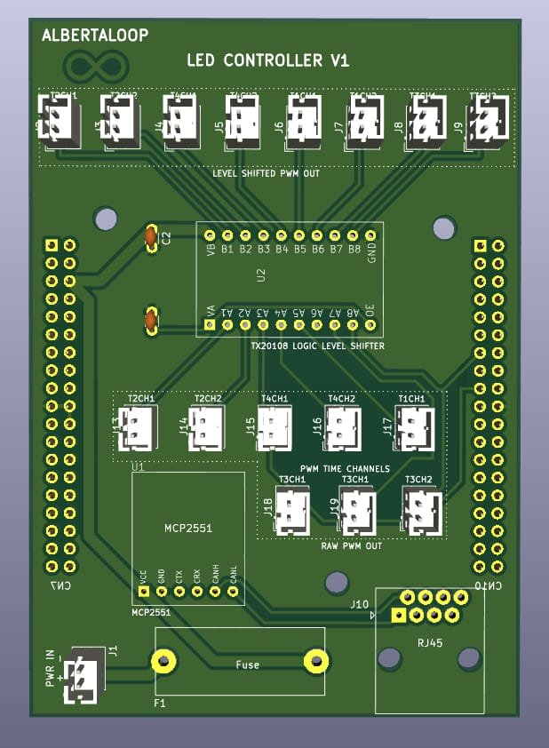

Eight level-shifted PWM outputs through a TXS0108 logic level shifter (3.3 V → 5 V for the WS2812B strips), with the timer channels broken out to headers.

### CAN Splitter and Pi Breakout

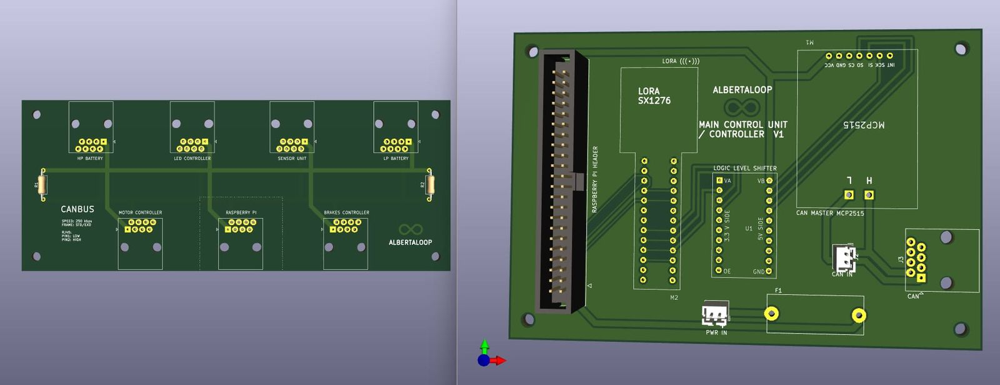

A CAN splitter board distributes the bus to every node over RJ45, and a breakout board connects the Raspberry Pi used as the Main Control Unit / controller.

## Bringing Up CAN

Before writing any subsystem code, I brought up the bxCAN peripheral on the Nucleo-F446RE step by step. That work lives in the CANdrivers branch, which has three test projects:

1. **Loopback:** the CAN peripheral receives its own frames internally, which checks the bit timing and filters without needing a bus.
2. **Loopback IT:** the same, but interrupt driven (TX mailbox empty and RX FIFO pending callbacks).
3. **Normal mode, 2 nodes:** two Nucleos on a real bus through transceivers.

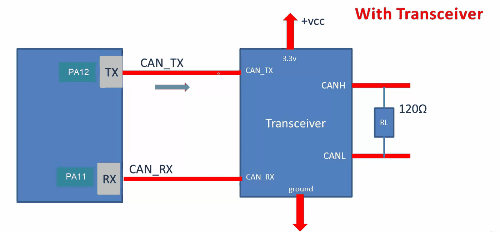

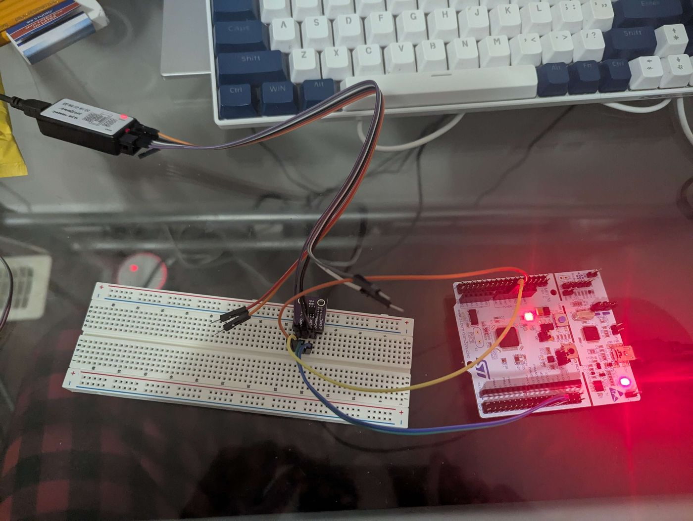

In loopback mode, the frame shows up on the logic analyzer, which decodes the identifier, data bytes and CRC:

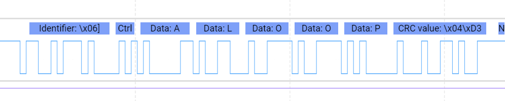

In the two-node test, node 1 sends a **data frame** (`0x65D`) with an LED number every second, and node 2 lights up the matching LED. Every 4 seconds node 1 also sends a **remote frame** (RTR, `0x651`) asking for 2 bytes, and node 2 answers with a data frame containing `0xABCD`. Everything is interrupt driven, and both sides log over UART.

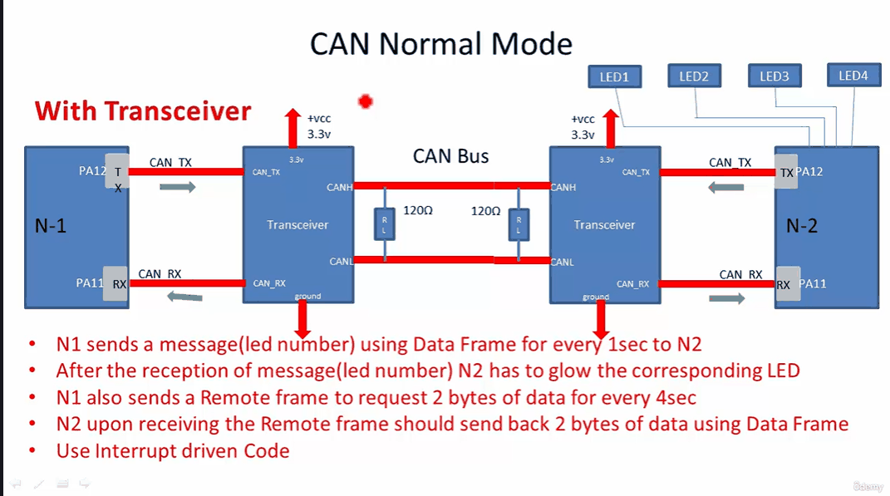

```c
if (RxHeader.StdId == 0x65D && RxHeader.RTR == 0) {
    LED_Manage_Output(rcvd_msg[0]);          // data frame from N1
} else if (RxHeader.StdId == 0x651 && RxHeader.RTR == 1) {
    Send_response(RxHeader.StdId);           // remote frame: reply with 0xABCD
} else if (RxHeader.StdId == 0x651 && RxHeader.RTR == 0) {
    sprintf(msg, "Reply Received : %#X\r\n", rcvd_msg[0] << 8 | rcvd_msg[1]);
}
```

## CAN Message Protocol

Every node uses the same CAN setup: standard 11-bit IDs, interrupts on TX mailbox empty, RX FIFO 0 pending and bus-off, and a basic timer that sends the heartbeat. Each subsystem owns a block of 256 IDs:

$$
\begin{array}{|l|c|c|l|}
\hline
\textbf{Node} & \textbf{ID Range} & \textbf{Heartbeat} & \textbf{Payload} \\
\hline
\text{Brakes} & \texttt{0x200–0x2FF} & \texttt{0x299} & \text{brake state (engaged / released)} \\
\text{Motor Driver} & \texttt{0x300–0x3FF} & \texttt{0x399} & \texttt{crawl\_mode},\ \texttt{motor\_speed}\text{ (0–100, 255 = reverse)} \\
\text{LED Controller} & \texttt{0x400–0x4FF} & \texttt{0x499} & \text{current FSM state} \\
\hline
\end{array}
$$

The pod side is plain SocketCAN, so a node can be tested from the Pi's terminal with `cansend`, and `candump` shows every heartbeat.

## Brakes Controller Firmware

The brakes node is written directly on the HAL, without CubeMX generated init code: the HSE + PLL clock, GPIO, UART, CAN and timer are all configured by hand. It listens for two commands:

$$
\begin{array}{|c|l|}
\hline
\textbf{ID} & \textbf{Action} \\
\hline
\texttt{0x201} & \text{Engage brakes} \\
\texttt{0x202} & \text{Disengage brakes} \\
\hline
\end{array}
$$

```c
void Manage_Solenoids()
{
  GPIO_PinState state = (brakes_status == 1) ? GPIO_PIN_SET : GPIO_PIN_RESET;
  HAL_GPIO_WritePin(GPIOA, GPIO_PIN_8,  state);
  HAL_GPIO_WritePin(GPIOA, GPIO_PIN_9,  state);
  HAL_GPIO_WritePin(GPIOB, GPIO_PIN_4,  state);
  HAL_GPIO_WritePin(GPIOB, GPIO_PIN_10, state);
}
```

All four solenoid outputs switch together, and the main loop is just `while(1);`. Everything happens in the CAN RX callback and in the TIM6 interrupt, which broadcasts the `0x299` heartbeat.

## Motor Driver Firmware

The motor controller takes a 0–3.3 V throttle signal, so the node uses the Nucleo's **12-bit DAC** to generate it, plus a GPIO for the reverse line:

$$
\begin{array}{|c|l|r|}
\hline
\textbf{ID} & \textbf{Action} & \textbf{Speed} \\
\hline
\texttt{0x301} & \text{Stop} & 0\% \\
\texttt{0x302} & \text{Speed }10\% & 10\% \\
\texttt{0x303} & \text{Speed }30\% & 30\% \\
\texttt{0x304} & \text{Speed }50\% & 50\% \\
\texttt{0x305} & \text{Speed }70\% & 70\% \\
\texttt{0x306} & \text{Speed }100\% & 100\% \\
\texttt{0x3FF} & \text{Reverse} & - \\
\texttt{0x310} & \text{Crawl mode} & 35\% \\
\hline
\end{array}
$$

```c
else if (RxHeader.StdId == 0x304 && RxHeader.RTR == 0)
{   // 50%
    HAL_GPIO_WritePin(REVERSE_PORT, REVERSE_PIN, GPIO_PIN_SET); // ensure forward
    HAL_DAC_SetValue(&hdac, DAC_CHANNEL_1, DAC_ALIGN_12B_R, 0.50 * DAC_MAX);
    HAL_DAC_Start(&hdac, DAC_CHANNEL_1);
    motor_speed = 50;
}
```

Any of the fixed speed commands drops the node out of crawl mode. In crawl mode, the main loop toggles the direction line every second for the demo. The `0x399` heartbeat reports the crawl flag and the current speed, and everything is also logged over UART for debugging. I checked the DAC output with a multimeter at each step (0, 10, 30, 50, 70 and 100%).

## LED Controller Firmware

The LED node shows the pod's state on **WS2812B** strips (150 LEDs). WS2812Bs need a strict ~800 kHz one-wire signal, so the bits are generated with **TIM1 PWM + DMA** instead of bit-banging:

- TIM1 runs at a period of 90 ticks (72 MHz / 90 = 800 kHz).
- A `1` bit is sent as a long high pulse and a `0` bit as a short one, by writing a different compare value into the DMA buffer.
- Each LED is 24 bits (GRB), followed by 50 low slots for the reset latch.
- The same buffer goes out on **TIM1 CH1 and CH2** at the same time, so two strips show the same pattern.

```c
for (int i = 23; i >= 0; i--) {
    pwmData[indx++] = (color & (1 << i)) ? 42 : 21;   // long pulse = 1, short pulse = 0
}
...
HAL_TIM_PWM_Start_DMA(&htim1, TIM_CHANNEL_1, (uint32_t *)pwmData, indx);
HAL_TIM_PWM_Start_DMA(&htim1, TIM_CHANNEL_2, (uint32_t *)pwmData, indx);
```

The DMA complete callback stops both channels and sets a `datasentflag`, so a new frame is never started in the middle of one. The CAN RX callback maps `0x401–0x407` to a state, and the main loop redraws the animation every 30 ms at 40% brightness:

$$
\begin{array}{|c|l|l|}
\hline
\textbf{ID} & \textbf{State} & \textbf{Pattern} \\
\hline
\texttt{0x401} & \text{FAULT} & \text{Red comet} \\
\texttt{0x402} & \text{SAFE TO APPROACH} & \text{Green comet} \\
\texttt{0x403} & \text{READY TO LAUNCH} & \text{Blue comet} \\
\texttt{0x404} & \text{LAUNCH (unused)} & \text{Off} \\
\texttt{0x405} & \text{CRAWLING} & \text{Moving blue / yellow split} \\
\texttt{0x406} & \text{BRAKING} & \text{Blinking blue / yellow comet} \\
\texttt{0x407} & \text{DEBUG} & \text{Blinking yellow comet} \\
\hline
\end{array}
$$

## Integration

With all the nodes flashed, the full chain works end to end: the Pi sends commands over the bus and the subsystems react and report back with heartbeats.

