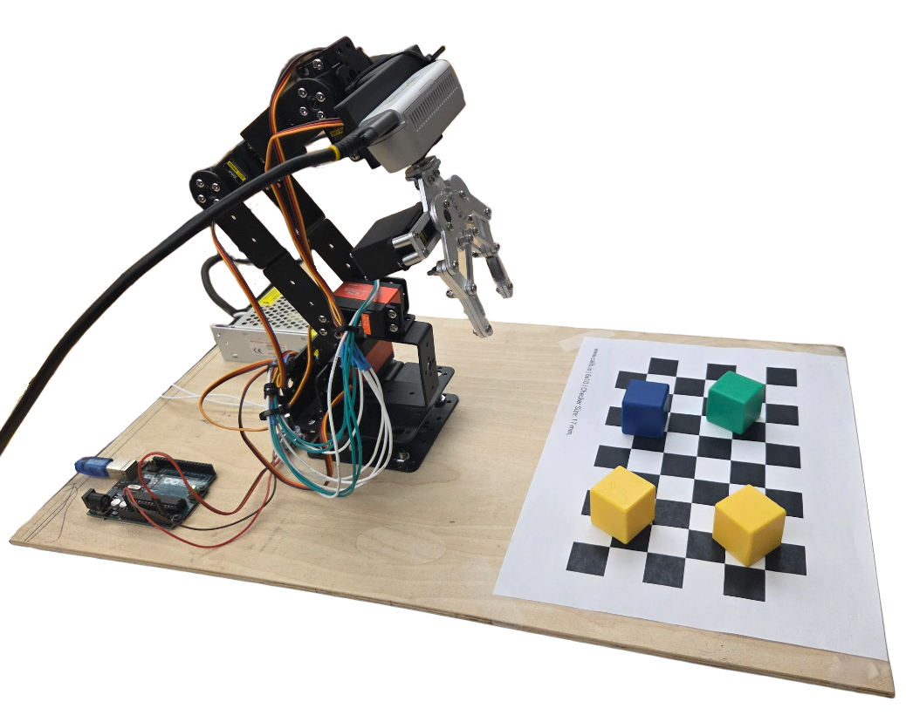

<video autoplay loop muted playsinline style="width:100%; height:auto;">
  <source src="/assets/visarm/visarm-demo.mp4" type="video/mp4">
</video>

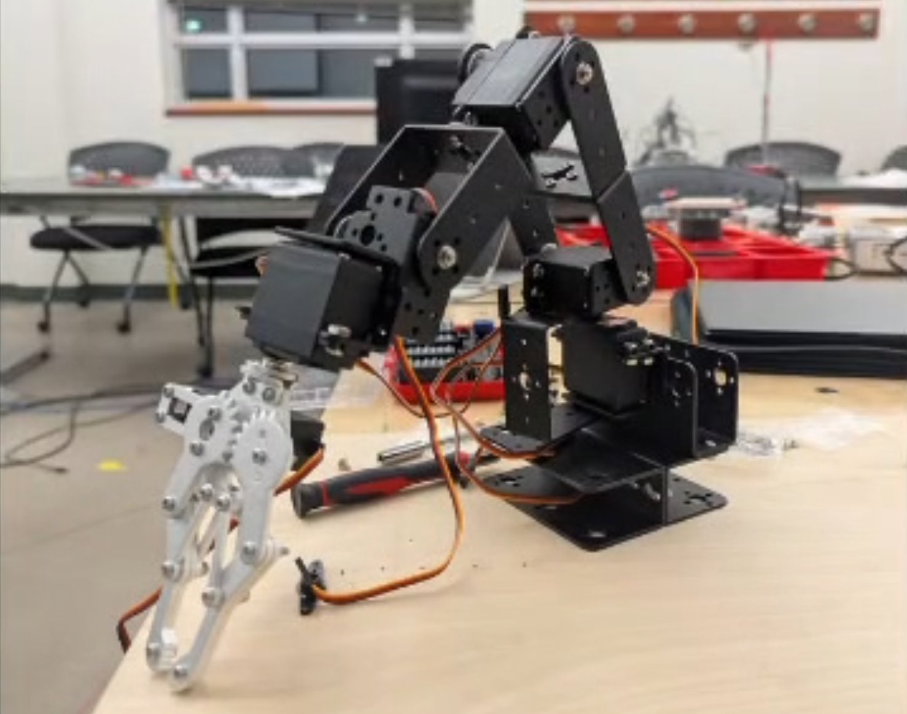

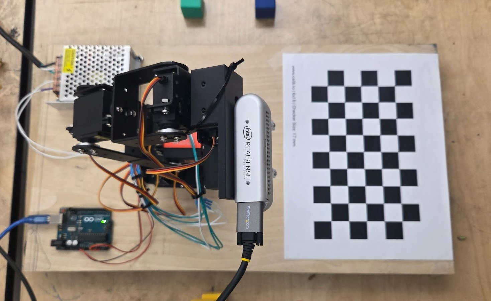

Visarm is our CMPUT 312 final project (with Krupal Shah): a vision guided pick-and-place system that colour sorts cubes. The camera image is undistorted, a checkerboard is used as the reference plane to map pixels into robot coordinates, inverse kinematics finds the joint angles, and after every pick the arm comes back to check whether it actually grabbed the cube before dropping it into the bin for that colour.

**[Project Report (PDF)](/assets/visarm/visarm-report.pdf)** · **[Code on GitHub](https://github.com/jaz404/visarm)** · **[Demo Video](https://youtu.be/dQCW4TNUgEI)**

## Hardware

The base is a ~$80 Amazon arm. It's sold as 6 DoF but really has 5 functional degrees of freedom, all sheet metal, with MG996R servos (~13 kg·cm) and no feedback at all. An Intel RealSense D435i sits on joint 4 in a 3D printed bracket, and because of the extra weight the base and shoulder servos had to be swapped for 22.8 kg·cm Miuzei servos.


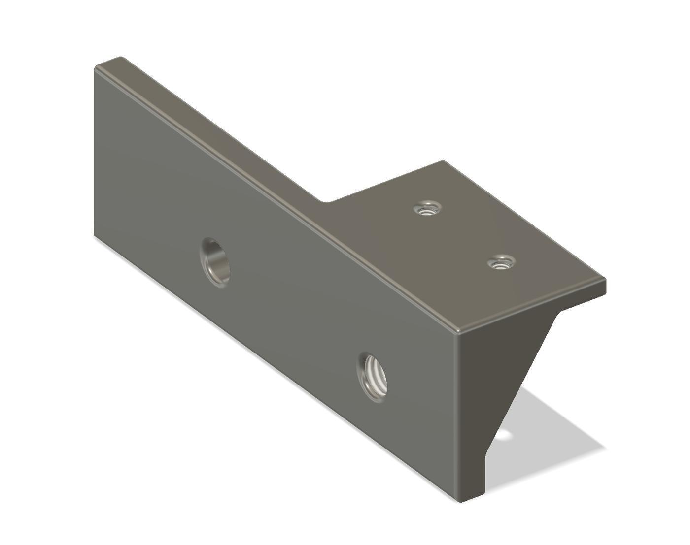

An Arduino UNO with a PCA9685 16 channel PWM driver controls the servos, all powered from a 5 V / 10 A supply. Everything is mounted on a 1/4" plywood board along with a 6×10 checkerboard (23 mm tiles) that defines the workspace.

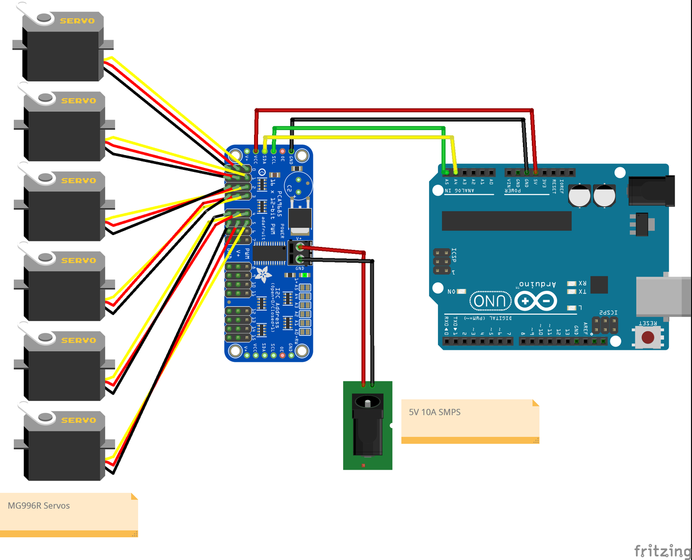


## Client–Server Setup

The laptop does all the heavy lifting (camera, calibration, coordinate transforms, forward / inverse kinematics) and the Arduino just turns joint angles into PWM. They talk over USB serial with a tiny ASCII protocol:

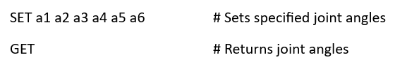

## Forward Kinematics

Frames were assigned to every joint using the Denavit–Hartenberg convention:

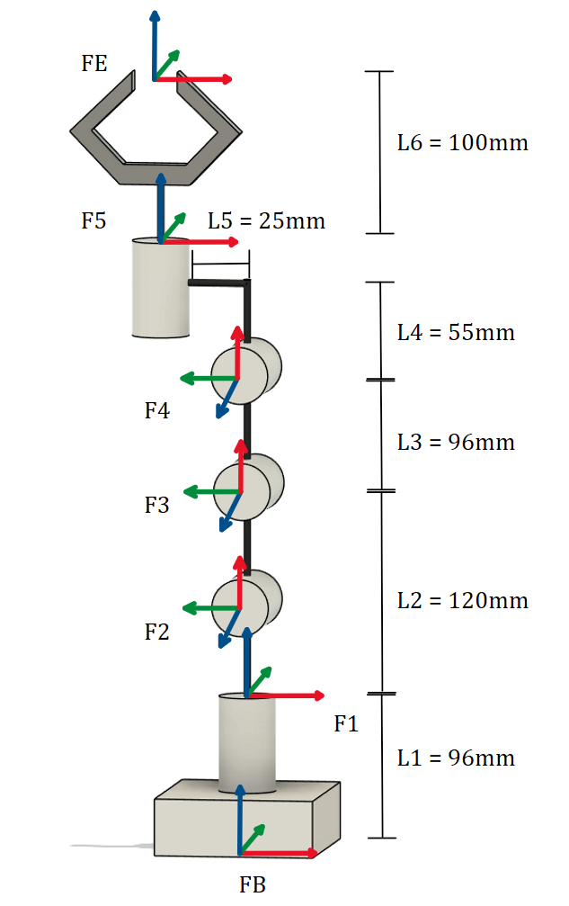

| Link (i) | θ<sub>i</sub> (rad) | α<sub>i-1</sub> (rad) | d<sub>i</sub> (mm) | a<sub>i-1</sub> (mm) |
| -------- | ------------------- | --------------------- | ------------------ | -------------------- |
| 1        | θ<sub>1</sub>       | π/2                   | 96                 | 0                    |
| 2        | θ<sub>2</sub>       | 0                     | 0                  | 120                  |
| 3        | −θ<sub>3</sub>      | 0                     | 0                  | 96                   |
| 4        | −θ<sub>4</sub> + π/2 | π/2                  | 0                  | 25                   |
| 5        | θ<sub>5</sub>       | 0                     | 55 + 100           | 0                    |

Multiplying all the transforms (<sup>B</sup>T<sub>E</sub> = <sup>B</sup>T<sub>1</sub> <sup>1</sup>T<sub>2</sub> <sup>2</sup>T<sub>3</sub> <sup>3</sup>T<sub>4</sub> <sup>4</sup>T<sub>5</sub> <sup>5</sup>T<sub>E</sub>) gives the end-effector position from the base frame.

## Inverse Kinematics

Even though the arm is 5 DoF, joint 5 (wrist roll) is fixed so it's solved as a 4 DoF arm. θ<sub>1</sub> comes straight from atan2(y, x), then the plane is shifted by L<sub>1</sub> and θ<sub>2</sub>, θ<sub>3</sub>, θ<sub>4</sub> are solved like a planar arm with the law of cosines.

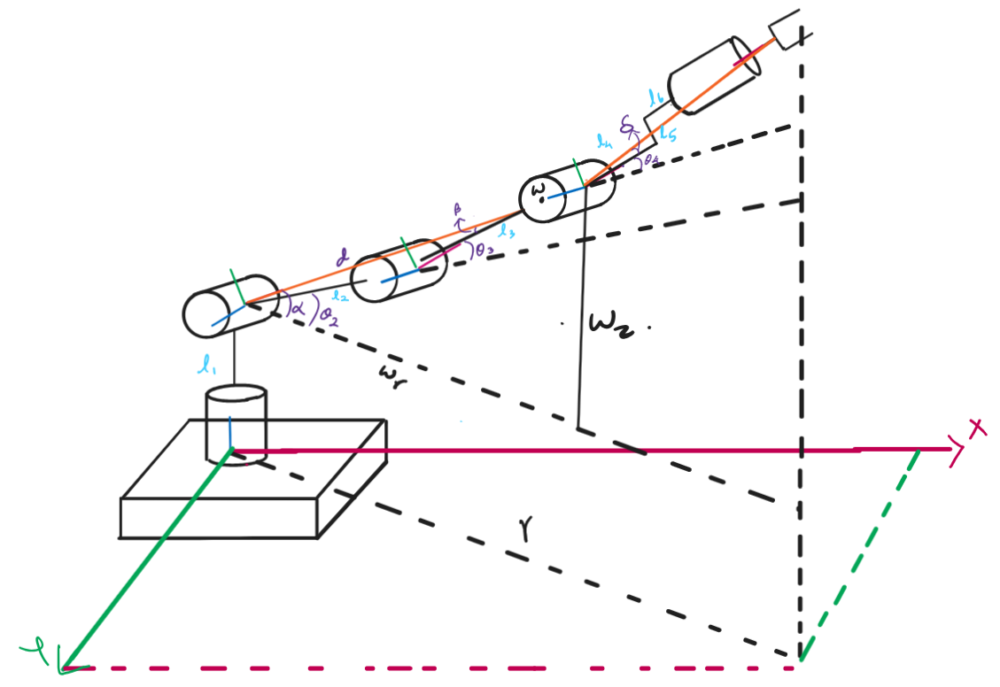

```
L_ee = sqrt(L5² + (L4 + L6)²)
r    = x·cos θ1 + y·sin θ1
wr   = r − L_ee·cos φ
wz   = z − L_ee·sin φ
d    = sqrt(wr² + wz²)

θ3 = arccos( (d² − L2² − L3²) / (2·L2·L3) )
α  = atan2(wz, wr)
β  = arccos( (L2² + d² − L3²) / (2·L2·d) )
θ2 = (α ± β) − π/2
δ  = atan2(L5, L4 + L6)
θ4 = θ2 + θ3 + δ − φ + π/2
```

This gives multiple candidate solutions, so each one is plugged back into the forward kinematics and only the ones that actually land on the target are kept.

## Camera Calibration and Mapping

The RealSense was calibrated with MATLAB's Camera Calibrator using ~15 checkerboard images, ending up with a mean reprojection error of about 0.20 px. There was a small amount of radial distortion that gets corrected on every frame.

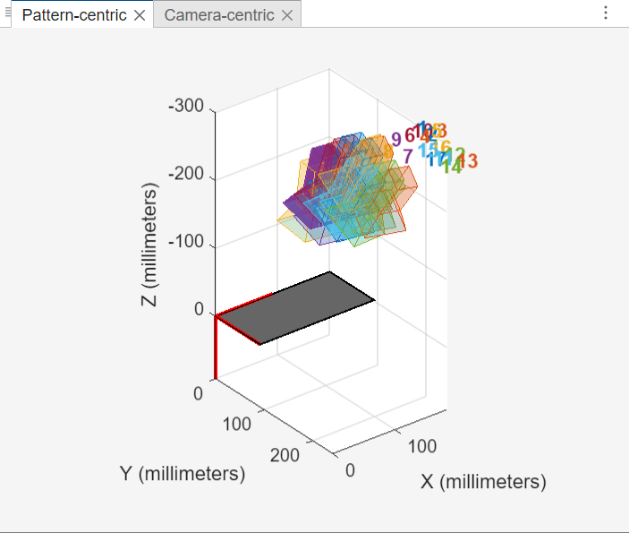

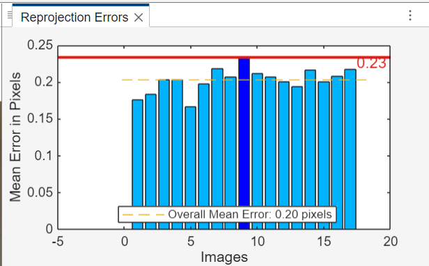

```
K = [ 898.3306    0       633.6178
        0       898.7783  379.6450
        0         0         1      ]

d_radial = [ 0.1402, −0.2897 ]
```

Since the workspace is flat and the cubes are a known height, Z = 0 on the checkerboard plane, which turns pixel → board into a homography. The board → robot transform is read off the physical setup, so any pixel can be mapped straight into the robot frame:

```
p_robot = T_checker→robot · T_image→checker · p_image
```

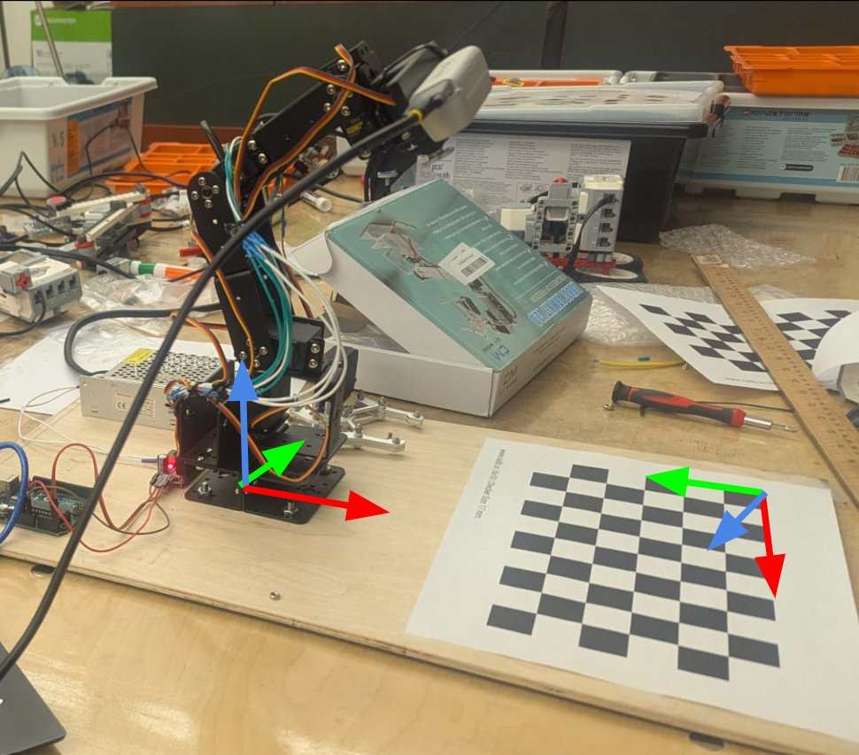

## Object Detection

The arm first moves to a survey position (`[−6, 29, 77, 90, 0, −10]`) where the whole board is visible.

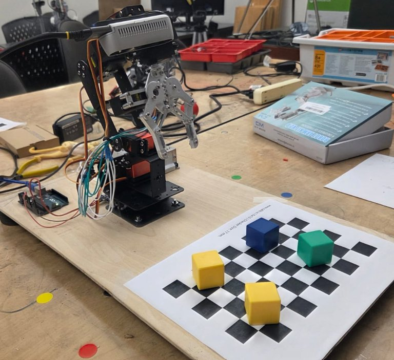

From there every frame goes through the same pipeline:

1. Detect the four outer corners of the checkerboard and save the bounds
2. Undistort the frame with K and d
3. CLAHE on the V channel (HSV) to deal with lighting changes
4. Mask everything outside the board
5. HSV colour thresholding → median filter → morphological opening → contours filtered by area and shape (to ignore hands and noise)
6. Small vertical offset correction (up to 1 cm) since the blob centroid isn't the top face of the cube

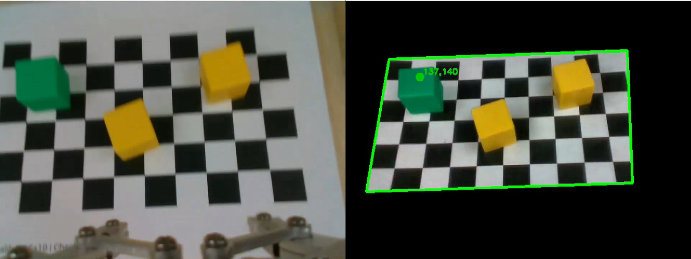

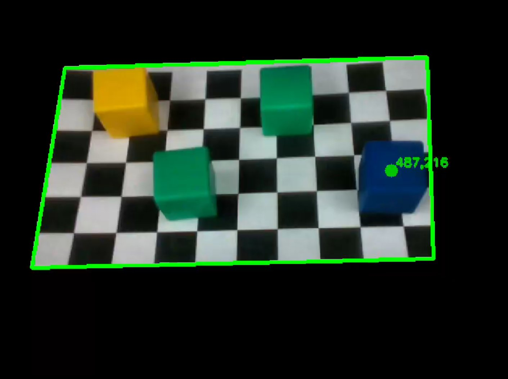

## Pick-and-Place

With a cube located, IK sends the arm down to it (3 cm cube + 2 cm margin = 5 cm grasp height), then it comes back to the survey position and the wrist camera checks a fixed region of interest for a coloured blob of the right size, shape and position. If nothing's in the gripper it tries again, otherwise the cube goes to the bin for its colour.

<div class="video-wrap">
  <iframe
    src="https://www.youtube.com/embed/dQCW4TNUgEI"
    title="Visarm demo video"
    frameborder="0"
    allowfullscreen>
  </iframe>
</div>

## Results

- ~1 cm positional error in both x and y
- ~70% successful pickups (most misses are when the cube is rotated, since joint 5 is fixed at 0°)
- ~90% correct colour classification (HSV is pretty sensitive to lighting)

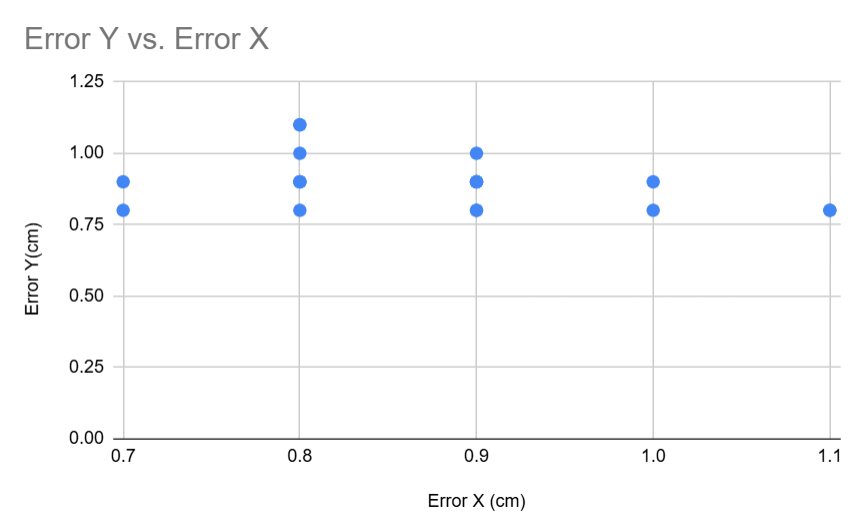

The joints also weren't perfectly aligned when assembled (θ<sub>1</sub> needed a 6° fix), and the weight of the camera, mount and cube makes the arm sag. Two extra corrections handle that: an origin offset on θ<sub>2</sub>, and a position dependent offset on θ<sub>1</sub> once the cube is past a certain X.

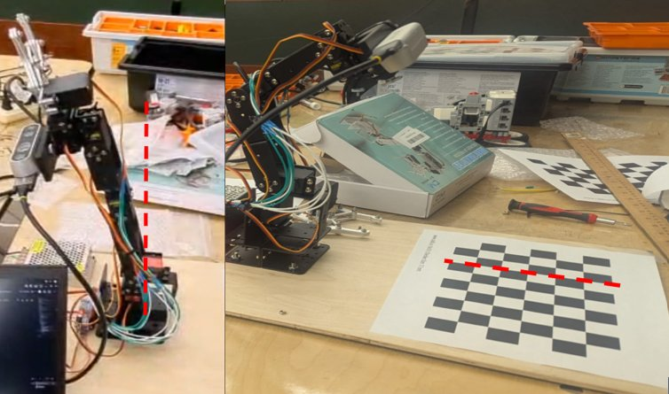

## What's Next

- **ArUco markers instead of the checkerboard.** The checkerboard bounding box isn't always detected reliably and the error builds up over multiple runs. ArUco markers would allow recalibrating every iteration.

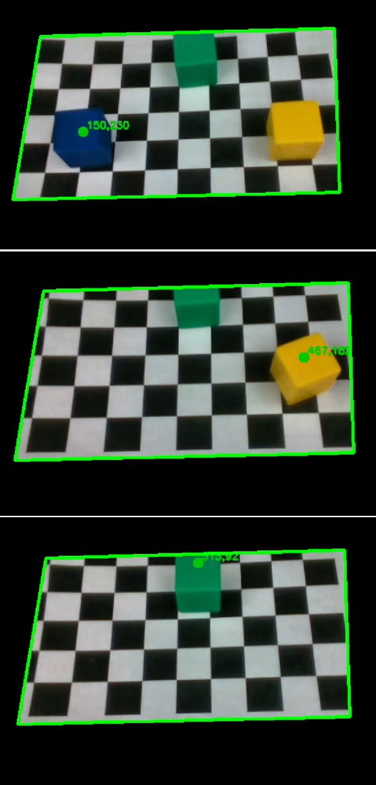

- **Visual servoing for the grasp.** Using the two gripper tips as points and the two vertical edges of the cube as lines, a point-to-line error could line the gripper up before it closes, instead of relying on hand tuned offsets.

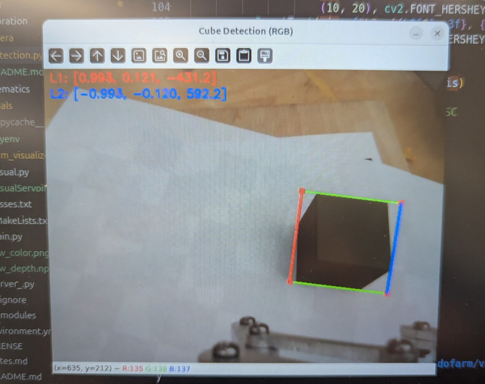

- **Saving the gripper servo.** It overheated and had to be replaced because it was stalling against the cube with no feedback. Checking for the cube during the pickup (visually or with limit switches) would let the grip be relaxed once it's holding something.

Huge thanks to Prof. Martin Jagersand and our TAs Riley Zilka and Justin Valentine, and to Nakamura et al.'s [RBE3001](https://github.com/KaiNakamura/RBE3001) project for the inspiration.
