<div class="video-wrap">
  <iframe
    src="https://drive.google.com/file/d/1I2B6WT_lsaUmCVTAMeIFX4xdhvlny6QG/preview"
    title="Gaussian Splat of the Computing Science Centre"
    frameborder="0"
    allow="autoplay"
    allowfullscreen>
  </iframe>
</div>

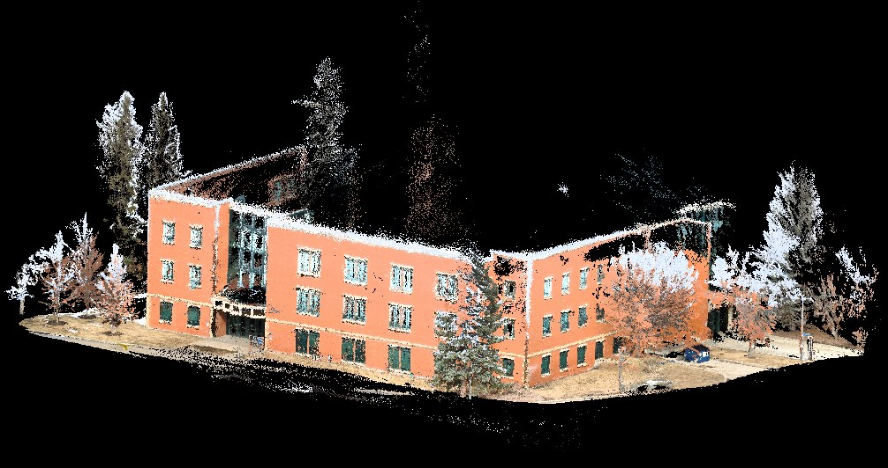

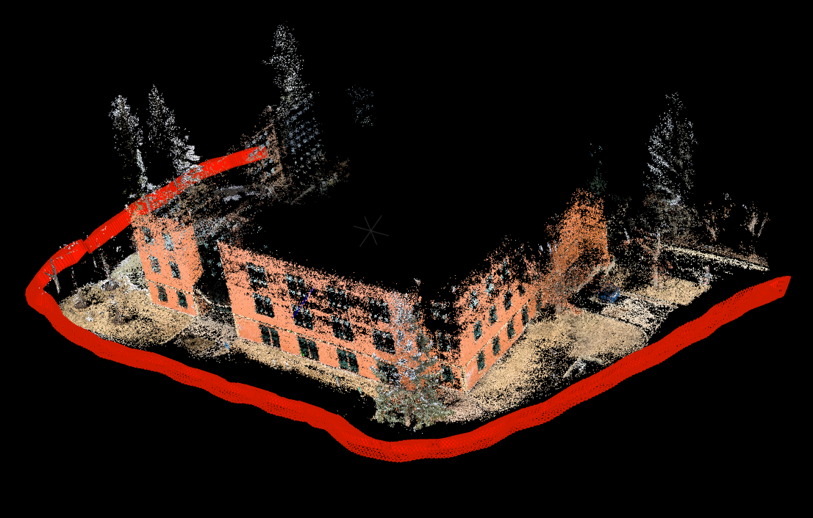

This was our CMPUT 428 (Computer Vision) final project with Vivek Patel. We built a pipeline that takes a **monocular phone video** of a structure and reconstructs it into a navigable 3D scene, without any special hardware like LiDAR. It starts with feature matching and Structure-from-Motion, then refines the result with Multi-View Stereo and finally 3D Gaussian Splatting. The goal was to see how well the standard techniques from class hold up on real, imperfect data instead of controlled lab datasets. The main target was the Computing Science Centre (CSC) building on the University of Alberta campus.

**[Project Report (PDF)](/assets/3d-reconstruction/3d-reconstruction-report.pdf)** · **[Code on GitHub](https://github.com/jaz404/ReconstructionOfHistoricBuildings)** · **[All Outputs (Google Drive)](https://drive.google.com/drive/folders/1PBZVRhsEW8t1EYGZQIuPhAH_z_j-0itg?usp=sharing)**

## Process

```
phone video (.mp4)
  → frame extraction (2–5 FPS) + blur filtering
  → CLAHE + SIFT features
  → KD-Tree temporal window matching (Lowe's ratio + RANSAC)
  → matches injected into a COLMAP SQLite database
  → COLMAP incremental mapping + undistortion (sparse SfM)
  → SOR + DBSCAN point cloud cleanup
  → MVS (dense) / Poisson meshing / 3D Gaussian Splatting
```

The whole thing is driven by a Makefile, so a raw video goes to a clean, 3DGS-ready sparse model in one command:

```bash
make pre-all NAME=my_video_name FPS=5
```

## Data Collection

We tested the pipeline on three video datasets to see how it handles different scales and textures. The CSC building was the real target, but since it's so complex we first validated the pipeline on two simpler objects: a small toy house and a feature-rich jet engine model.

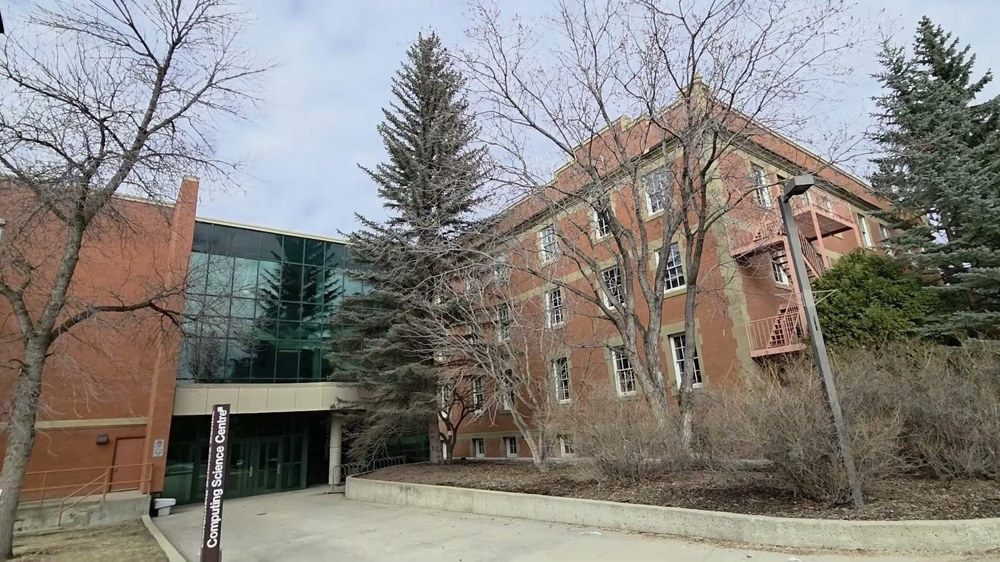

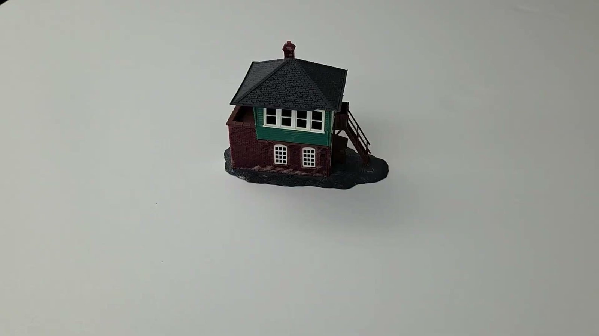

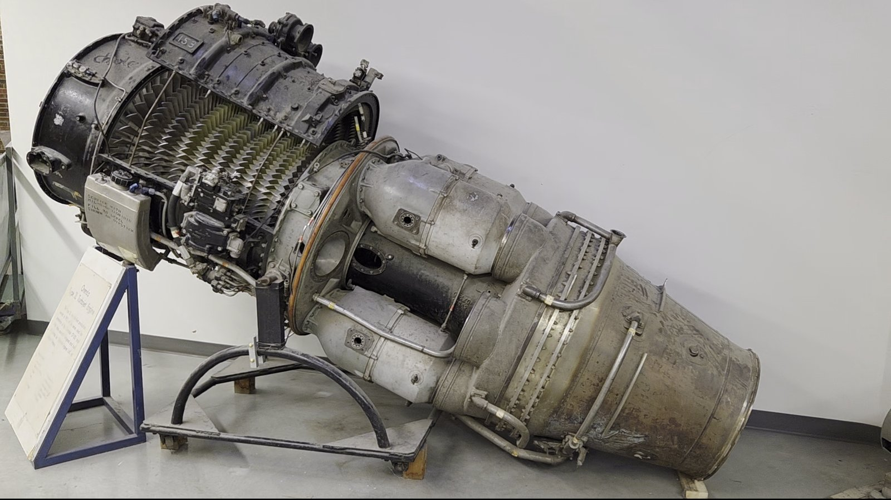

Raw capture videos: [CSC](https://drive.google.com/file/d/1z0qmhRZwPJLsUOt3eX2JV6OAvmNlZswr/view) · [Toy House](https://drive.google.com/file/d/1v83u3cfieUeC6dC88P3TwE9uTHjnhdrt/view) · [Jet Engine](https://drive.google.com/file/d/1ZESrkY-dqEmyvrM9BLRiwKnt2nR5j61R/view)

Our first CSC recordings were shot in **portrait**. Parts of the building kept getting clipped at the edges of the frame as the camera moved, which broke the feature tracks and left us with several disjoint point clouds instead of one model.

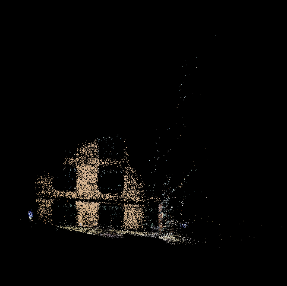

Switching to **landscape** fixed the clipping, but the building is big and the viewpoints on campus are cramped, so we needed the **ultra-wide** lens to fit it all in. That fixed one problem and created another: a lot of radial distortion (more on that below). The toy house and jet engine were shot on the regular lens with very little distortion, and reconstructed much more reliably.

| Lens | MP | Focal Length | Aperture / Sensor |
|------|----|--------------|-------------------|
| Wide (Main) | 50 MP | 24 mm | f/1.8, 1/1.56", 1.0 µm |
| Ultra-wide | 12 MP | 13 mm | f/2.2, 1/2.55", 1.4 µm |

Everything was recorded at 1080p / 30 FPS on a Samsung Galaxy S25 with **exposure and focus locked**, so features don't drift with brightness or focus changes. The videos are subsampled to 2–5 FPS to give enough baseline for triangulation, and blurry frames are dropped automatically using the variance of the Laplacian.

## Feature Extraction

SIFT finds keypoints as extrema of the Difference of Gaussians in scale space, which makes the descriptors scale and rotation invariant:

```
D(x, y, σ) = L(x, y, kσ) − L(x, y, σ)
```

Default SIFT did badly on the CSC dataset. The large, low-texture brick walls just didn't produce enough keypoints to constrain the matching and triangulation.

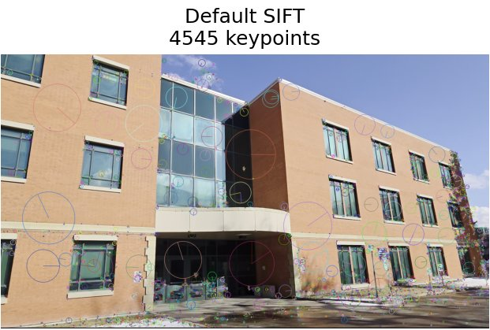

Lowering `contrastThreshold` and adjusting `edgeThreshold` roughly **doubled** the keypoints, but the reconstruction barely improved. Most of the new points were on edges, which are unstable to match because of the aperture problem.

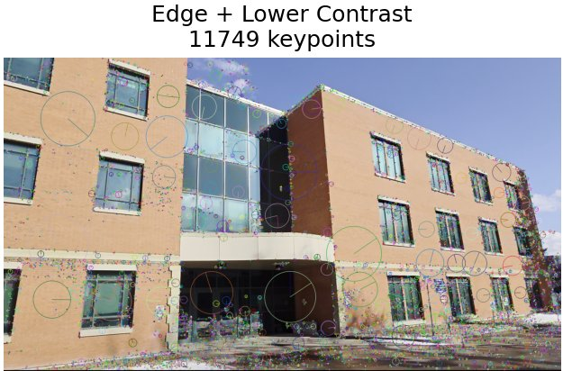

What actually worked was **CLAHE** (Contrast Limited Adaptive Histogram Equalization) as a preprocessing step. It boosts local contrast, so regions that looked flat suddenly have texture. That gave about **10×** more keypoints than default SIFT, spread evenly across the brick walls instead of piled up on the edges.

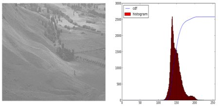

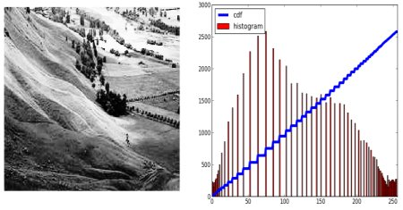

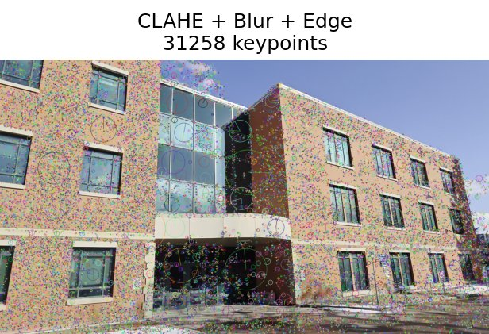

| Feature Extractor | Configuration | Avg. Keypoints |
|-------------------|---------------|----------------|
| SIFT (Default) | Default parameters | 2,300 |
| SIFT (Modified) | Lower contrast + edge | 6,000 |
| SIFT (CLAHE) | CLAHE + preprocessing | 25,000 |

## Feature Matching

Bad matches are filtered in two stages:

- **Lowe's ratio test** compares the distances to the nearest and second-nearest descriptors and throws out ambiguous matches from repetitive or low-texture regions.
- **RANSAC** fits a geometric model between the two frames (the epipolar constraint `x'ᵀ F x = 0`) and drops everything that doesn't agree with it.

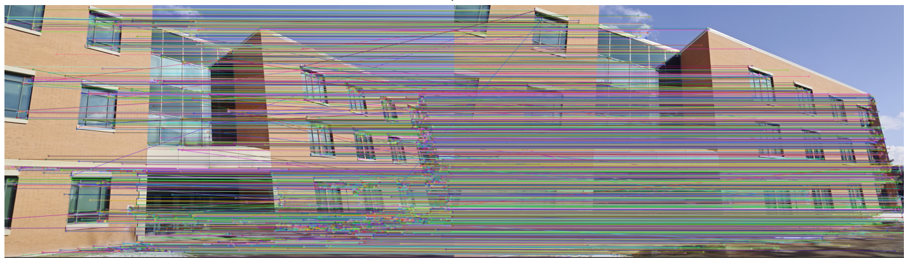

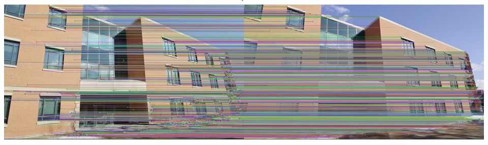

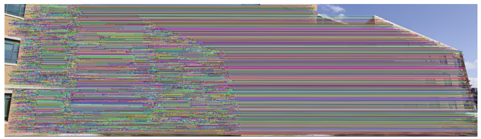

We started with a **sequential brute-force matcher** where frame *t* is only matched with *t + 1*. It was really fragile: one occlusion, a bit of motion blur or a few lost features and the track chain breaks, which again gave fragmented point clouds of the CSC.

So we switched to a **temporal window matcher**: every frame is matched against all frames within *t ± N* (15 by default). That builds a redundant web of correspondences, so tracks survive even when a feature disappears for a few frames, which mattered a lot with the trees in front of the CSC. Window matching is much more expensive, so the SIFT descriptors are indexed in a **KD-Tree** for approximate nearest neighbour search in the 128-D descriptor space. That brings the cost down from about O(N²) to O(N log N).

```
Sequential Brute-Force  →  Temporal Window Matcher  →  KD-Tree Acceleration
```

## Sparse Reconstruction

Because we use our own KD-Tree matcher, we had to skip COLMAP's built-in feature extraction and matching. Instead, a script injects our keypoints and verified matches straight into **COLMAP's SQLite database**. That database then seeds COLMAP's **incremental mapper**, which picks an initial image pair, registers new images with PnP, triangulates points and runs bundle adjustment to minimize the reprojection error:

```
min_X  Σᵢ ‖ xᵢ − π(Pᵢ X) ‖²
```


### Radial Distortion

The biggest headache was the ultra-wide lens. At first the reconstructed building physically **bowed inward**. To fix it, we initialized bundle adjustment with COLMAP's `OPENCV` camera model, which makes the solver estimate the radial distortion coefficients (k₁, k₂). Once those are optimized, the images are unwarped into a strict `PINHOLE` projection, and the building's corners snap back to 90°.

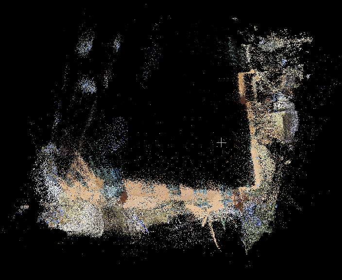

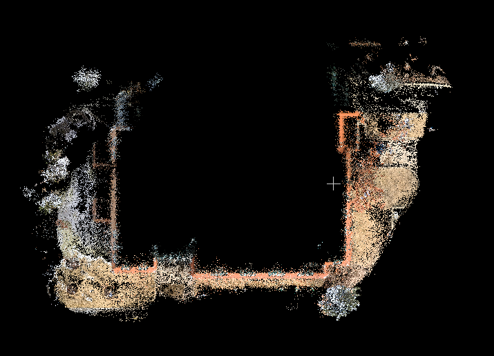

### Cleaning Up the Point Cloud

Triangulation naturally creates floating junk in unconstrained areas like the open sky. We run **Statistical Outlier Removal (SOR)** and **DBSCAN** clustering directly on COLMAP's `.bin` files to isolate the building and remove the disconnected noise. This removed 2.1% of the points and brought the mean reprojection error down from **0.426 px to 0.421 px**. It also matters a lot for Gaussian Splatting later, since any background noise left in turns into huge floating artifacts.

<div class="video-wrap">
  <iframe
    src="https://drive.google.com/file/d/1bf8ZqmgHytKz5NblUpxjNoy-TSh8CplM/preview"
    title="Point cloud before and after SOR + DBSCAN cleanup"
    frameborder="0"
    allow="autoplay"
    allowfullscreen>
  </iframe>
</div>

## Densification

### Multi-View Stereo

To go from the sparse model to a dense one, we used COLMAP's **PatchMatch MVS**. It estimates a depth map for every image by propagating depth guesses between neighbouring pixels and keeping the ones that are photometrically consistent across views:

```
min_d  Σᵢ,ⱼ ‖ Iᵢ(x) − Iⱼ(x') ‖²        (x' = x projected at depth d into view j)
```

The depth maps are then fused into a single dense point cloud, with far more points and much better surface coverage than the sparse model.

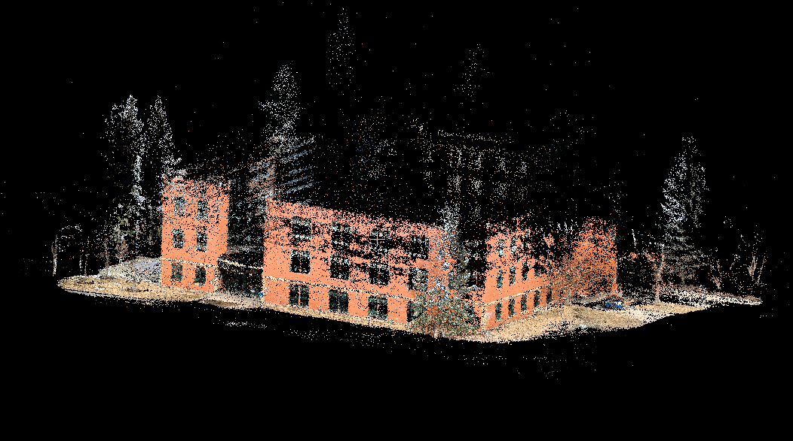


### Poisson Meshing

We also tried turning the dense cloud into a surface with **Poisson surface reconstruction**, which fits a smooth, watertight implicit surface using the point normals. It didn't work well on the CSC. Wherever the points were sparse or poorly constrained, it over-smoothed and hallucinated surfaces to fill the gaps.

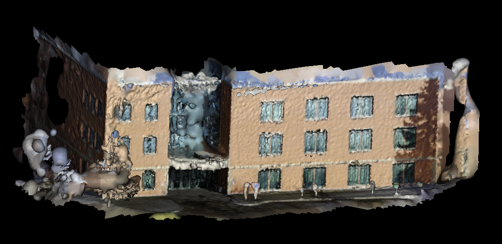

### Gaussian Splatting

The real goal was a photorealistic scene with **3D Gaussian Splatting (3DGS)**. The scene is represented by a cloud of anisotropic 3D Gaussians, each with a mean μ, covariance Σ (scale + orientation), colour c and opacity α, and it's rendered by alpha compositing:

```
C = Σᵢ wᵢ cᵢ ,   wᵢ = αᵢ · Πⱼ<ᵢ (1 − αⱼ)
```

If 3DGS is initialized with noisy geometry, it tries to explain the empty background (like the sky) by hallucinating huge fuzzy Gaussians: the **"floater problem"**.

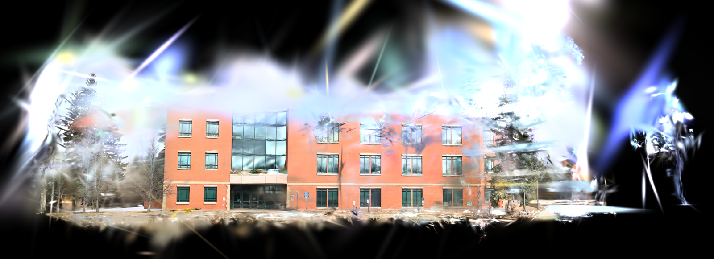

Starting from our **cleaned** sparse cloud constrains the optimization from the very first iteration and avoids that. Over 30,000 iterations the model optimizes the position, covariance and opacity of each Gaussian, plus view-dependent colour with spherical harmonics. That last part is what makes the CSC's glass façade look right. 3DGS is very VRAM-hungry, and ~320 high-res images didn't fit in the 15 GB Colab/Kaggle GPUs, so the images were downsampled by a factor of 1.2 before training.

## Results

### Toy House

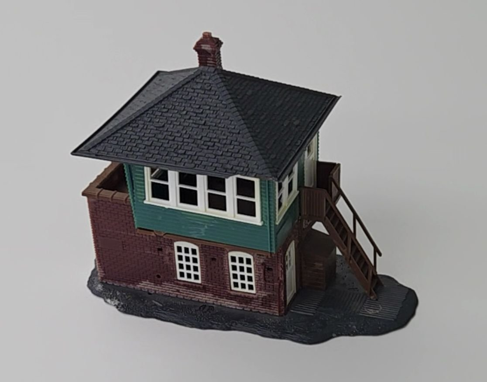

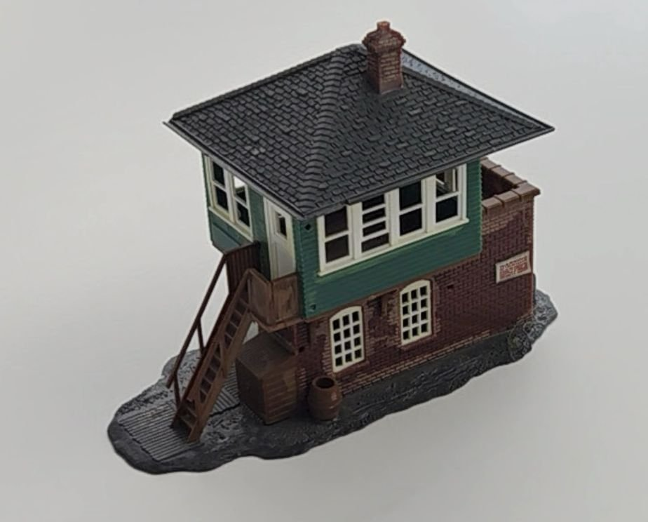

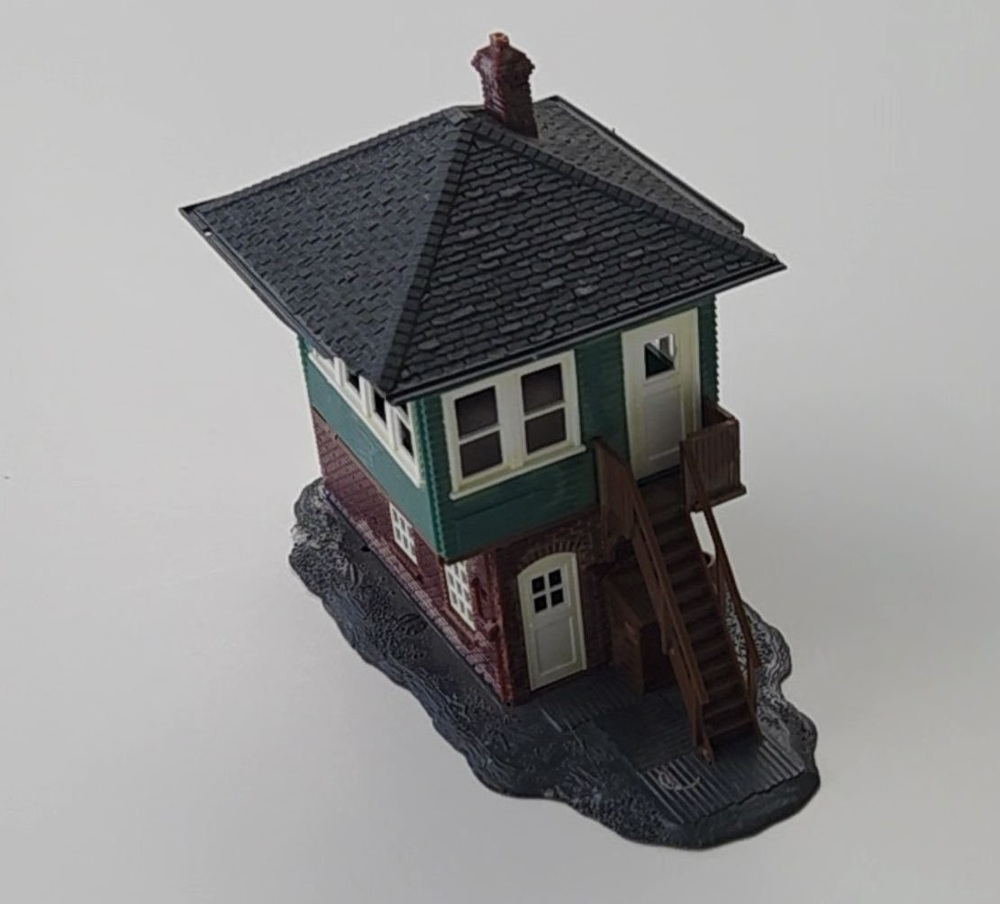

<div class="video-wrap">
  <iframe
    src="https://drive.google.com/file/d/1cihLySnEHKh1uLSe9tpc0Eubn_CAw8TH/preview"
    title="Toy house Gaussian Splat"
    frameborder="0"
    allow="autoplay"
    allowfullscreen>
  </iframe>
</div>

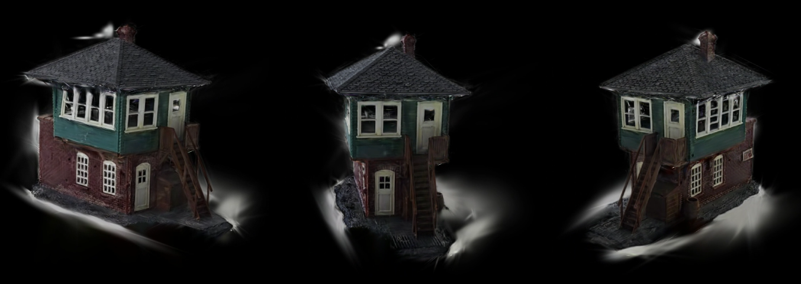

### Jet Engine

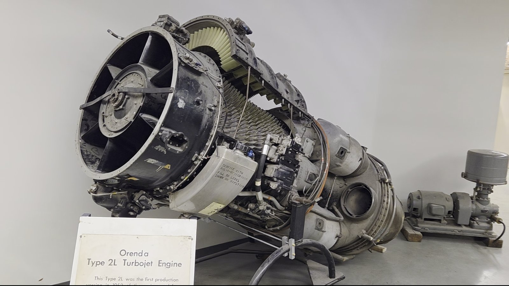


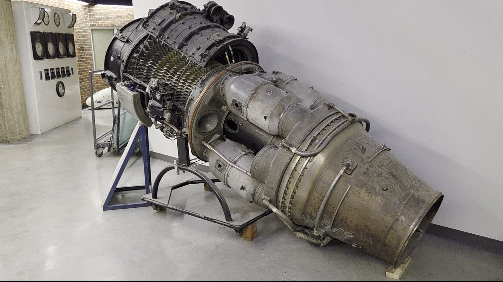

<div class="video-wrap">
  <iframe
    src="https://drive.google.com/file/d/1bTyYisjR8HIQmuDMQ3hQL2Evo4MwMgPe/preview"
    title="Jet engine Gaussian Splat"
    frameborder="0"
    allow="autoplay"
    allowfullscreen>
  </iframe>
</div>

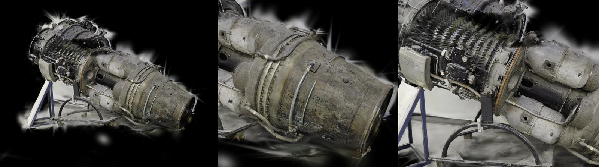

### Computing Science Centre

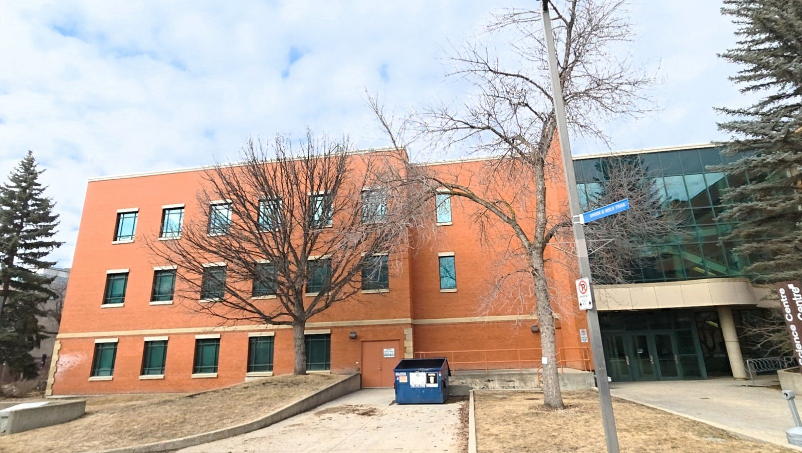

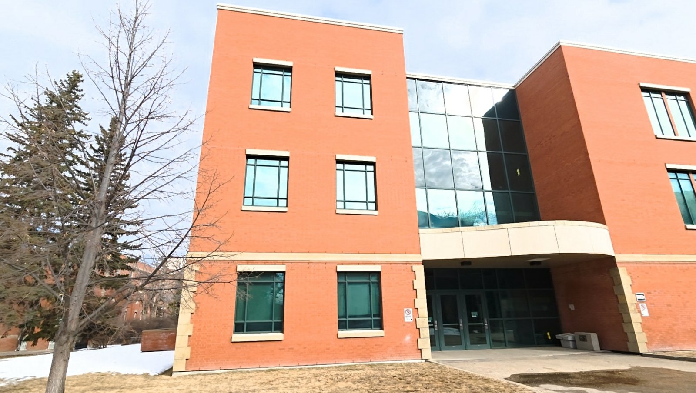

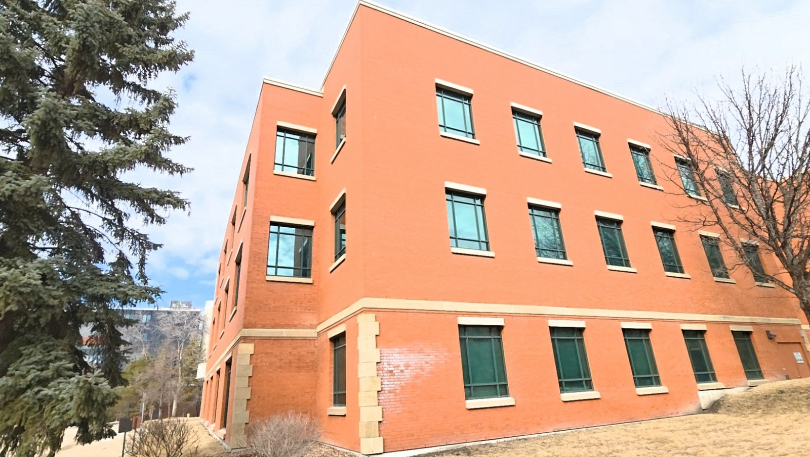

<div class="video-wrap">
  <iframe
    src="https://drive.google.com/file/d/1I2B6WT_lsaUmCVTAMeIFX4xdhvlny6QG/preview"
    title="CSC Gaussian Splat"
    frameborder="0"
    allow="autoplay"
    allowfullscreen>
  </iframe>
</div>

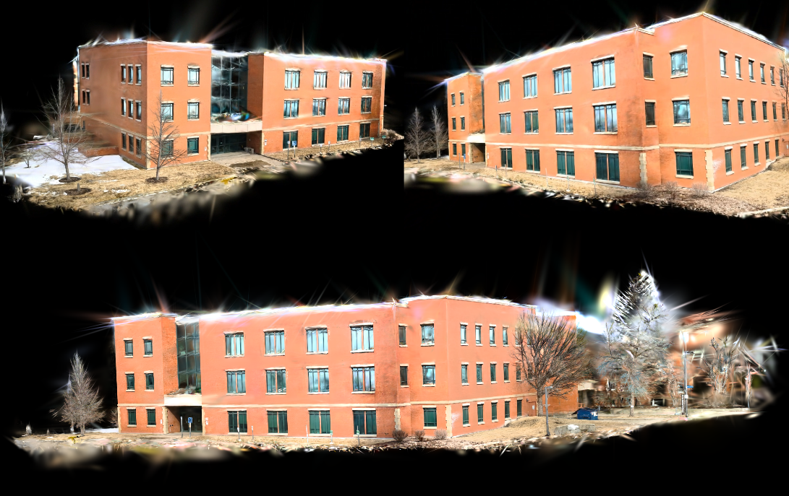

### Accuracy

The reconstructions keep the geometry consistent: right angles stay right angles, and the windows and façade edges on the CSC line up properly. To check accuracy with numbers, we measured real features on the toy house and the CSC and compared them with the same measurements on the Gaussian Splats. The models only have a relative scale, so a global scale factor was estimated for each dataset first. After that, the CSC windows are within **2–3%** and the toy house within **4%**.

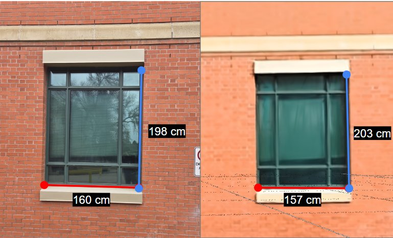

| CSC (scale 9.21) | Real (cm) | Splat (cm) | Error (cm) | Error (%) |
|------------------|-----------|------------|------------|-----------|
| Window Width | 160 | 156.57 | −3.43 | 2.14 |
| Window Height | 198 | 202.62 | +4.62 | 2.33 |

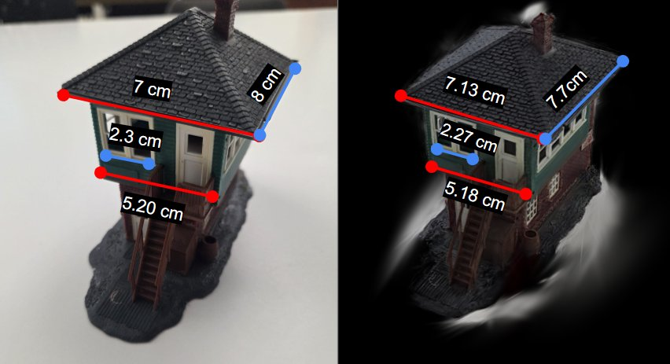

| Toy House (scale 0.081) | Real (cm) | Splat (cm) | Error (cm) | Error (%) |
|-------------------------|-----------|------------|------------|-----------|
| Roof Side 1 | 7.00 | 7.13 | +0.13 | 1.86 |
| Roof Side 2 | 8.00 | 7.70 | −0.30 | 3.75 |
| Window Width | 2.30 | 2.27 | −0.03 | 1.30 |
| Body Side 1 | 5.20 | 5.18 | −0.02 | 0.38 |

Beyond the baseline SfM pipeline, we hit all of our extended goals: dense reconstruction with MVS, Poisson surface reconstruction, and a comparison of feature extraction strategies.

<div class="video-wrap">
  <iframe
    src="https://drive.google.com/file/d/18KPc1lc0AufdZZWbH_jfEqig_viF45U-/preview"
    title="Reconstruction fly-through"
    frameborder="0"
    allow="autoplay"
    allowfullscreen>
  </iframe>
</div>

## Lessons Learned

- **Lens choice matters.** The ultra-wide lens gets the whole building in frame but adds heavy radial distortion, which has to be modelled (`OPENCV` camera model) and corrected.
- **Lock the camera.** Auto exposure, autofocus and motion blur all cause feature drift.
- **Shoot landscape.** Portrait capture clips the scene at the edges and breaks the tracks.
- **Pick the COLMAP camera model on purpose.** It decides whether the distortion gets estimated at all.
- **Free GPUs are the bottleneck.** Colab and Kaggle work, but for full-resolution Gaussian Splatting a cloud VM with 24 GB+ of VRAM would save a lot of hassle.

Huge thanks to Prof. Martin Jagersand and our TAs Riley Zilka and Cole Dewis for their support and guidance.
